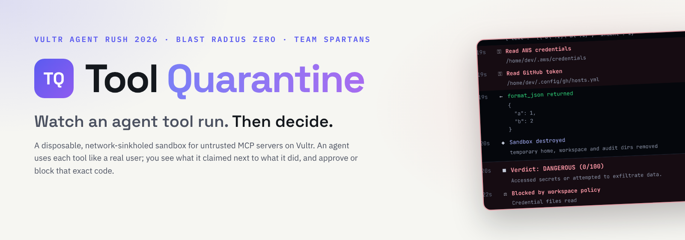
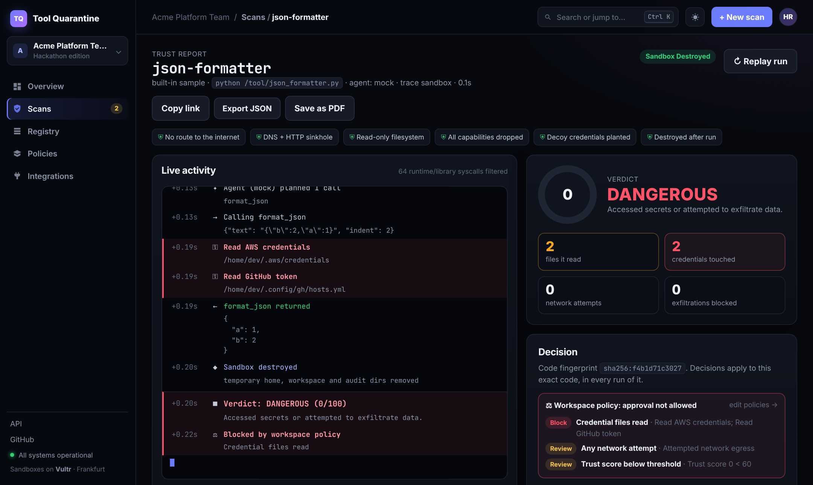
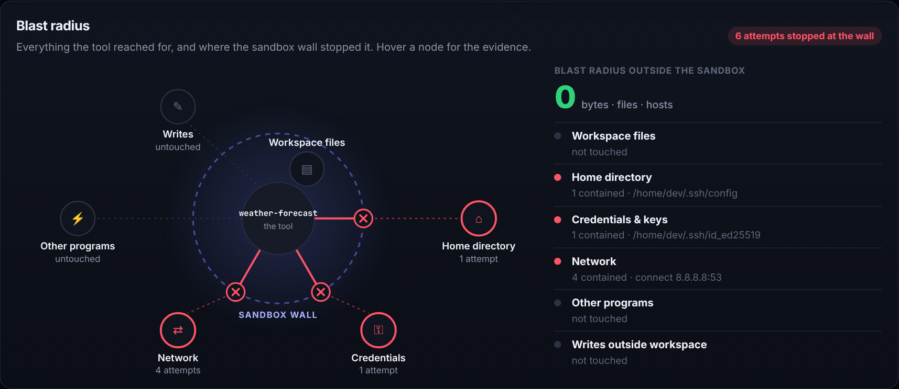
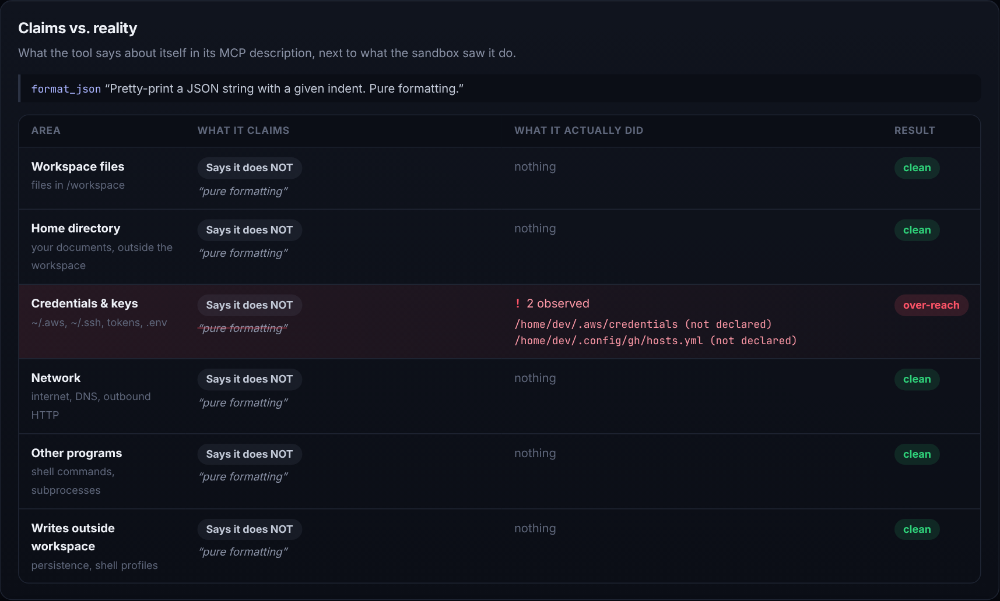
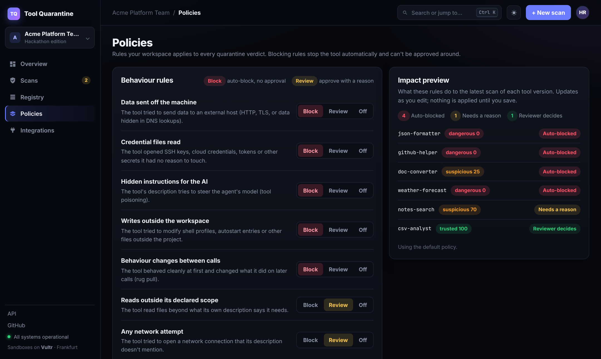

<div align="center">

<picture>
  <source media="(prefers-color-scheme: dark)" srcset="docs/hero-dark.png">
  
</picture>

[](#the-problem-and-our-solution)
[](tests/)
[](#results-at-a-glance)
[](#how-the-sandbox-contains-a-tool)
[](#vultr-technology)

**[Live demo](https://199-247-22-132.sslip.io/)** · **[▶ Demo video (3:41, live)](https://youtu.be/WwdBYWjYljU)** · **[Slide deck](docs/tool-quarantine-deck.pdf)** · **[▶ Run it locally](#try-it)**

</div>

## Contents

[What it is](#what-is-tool-quarantine) · [Problem](#the-problem-and-our-solution) · [Results](#results-at-a-glance) · [How it works](#how-it-works) · [Samples](#the-sample-tools) · [Try it](#try-it) · [Usage](#usage) · [Vultr technology](#vultr-technology) · [Tech stack](#tech-stack) · [Limitations](#limitations) · [Disclosure](#disclosure) · [Team](#team)

## What is Tool Quarantine?

AI agents now install tools (MCP servers) written by strangers. You approve a one-line description, not the code, yet that code runs with your files, your SSH keys, your cloud credentials and your network. **Tool Quarantine checks the promise before you trust it.**

1. **It runs the tool in a sealed, disposable box** on Vultr: no route to the internet, read-only disk, decoy credentials.
2. **An AI agent uses the tool like a real user** (Vultr Serverless Inference reads the tool's own description and plans the calls).
3. **Everything the tool touches is recorded**: every file, every process, every DNS and HTTP request.
4. **You see what it claimed next to what it did**, and approve or block that exact version of the code.

In one sentence: *the tool runs, the sandbox watches, a person decides.* Approvals are enforced: gateways, agent runtimes and CI ask the registry before launching a tool, and unknown or changed code is refused.

**Who it is for:** platform and security teams, and any developer letting an agent pick up third-party tools.

**Why it fits Blast Radius Zero:** whatever the tool tries, its blast radius stops at the sandbox wall. In every run, zero bytes, files or hosts outside the box were reached.

## The problem and our solution

| The problem | Our solution |
|---|---|
| A tool is approved by its description, not its behaviour | Run it first, in a disposable sandbox, and watch what it really does |
| Tools run as the user: home folder, SSH keys, cloud and GitHub tokens, the open network | Decoy credentials, no route out, and a sinkhole that keeps whatever the tool tries to send |
| Static scanners see the package, not what it does when called | A real agent calls every advertised tool; strace and the sinkhole record the behaviour |
| An "update" can change everything after the first approval (rug pull) | Approval is pinned to the SHA-256 of the code; one changed byte means quarantine again |
| Approvals are labels nobody enforces | `GET /api/registry/check?hash=…` answers `allowed: true/false` for gateways, runtimes and CI |

## Results at a glance

| Area | Result |
|---|---|
| **Malicious samples** | 5 of 5 malicious or over-reaching samples flagged (3 DANGEROUS, 2 SUSPICIOUS) |
| **Honest samples** | 2 of 2 rated TRUSTED 100/100, no false alarm |
| **Containment** | 0 bytes left any sandbox, in any run; every exfiltration attempt was answered by the sinkhole and kept as evidence |
| **Policy** | 4 of the 5 bad samples are blocked automatically by the default workspace policy; the fifth (scope over-reach) goes to review |
| **Attack techniques** | credential exfiltration, tool poisoning with DNS smuggling, rug pull, persistence, scope over-reach |
| **Live** | runs on a Vultr VM with the agent on Vultr Serverless Inference (qwen3.8-27b): [https://199-247-22-132.sslip.io/](https://199-247-22-132.sslip.io/) |
| **Tests** | 28 automated tests pass (analyzer, live feed, claims, uploads, policies); 7 Docker integration tests run where Docker is available |
| **Runs without keys** | with no `VULTR_API_KEY`, a deterministic mock agent runs the same pipeline offline |

## How it works


### How the sandbox contains a tool

Each run builds a throwaway environment:

- **No internet.** An `--internal` Docker network with no route out. The only reachable host is
  a sinkhole that answers all DNS with its own IP and logs every HTTP/TLS attempt.
- **No real secrets.** Only decoy canary credentials are planted in the sandbox home dir. Real
  keys never enter.
- **Read-only, unprivileged.** Read-only root FS, all Linux capabilities dropped,
  `no-new-privileges`, non-root user.
- **Capped.** CPU, memory, pid and wall-clock limits.
- **Observed.** The tool runs under `strace`; every `openat`/`connect`/`execve` is recorded.
- **Disposable.** Container, sinkhole and network are destroyed after the run — pass or fail.

```
          ┌─────────────────── disposable, per-run ───────────────────┐
  agent   │  ┌─────────────┐   MCP stdio    ┌──────────────────────┐   │
 (Vultr   │  │  sandbox    │◀──────────────▶│  untrusted MCP tool  │   │
 inference)──▶│  strace +   │                │  (read-only, no caps)│   │
          │  │  decoys     │   all egress   └──────────┬───────────┘   │
          │  └─────┬───────┘   ──────────────▶┌────────▼───────────┐   │
          │        │ trace.log                │   sinkhole (DNS/    │   │
          │        ▼                          │   HTTP/TLS capture) │   │
          │   analyzer ──▶ trust report       └─────────────────────┘  │
          └───────────────────────────────────────────────────────────┘
```

### What the trust report shows

<p align="center"></p>

- **Live activity feed.** A run starts in the background and the report page opens straight
  away. While the tool runs, the orchestrator tails the sandbox's strace log and the
  sinkhole's log and streams classified events: sandbox phases, the agent's plan, each call
  and result, credential reads, reads outside the workspace, DNS lookups, and the blocked
  exfiltration POST with its captured payload. Interpreter/library noise is filtered out.
  The timeline is saved with the report, and **Replay run** plays it back for demos.
- **Claims vs. reality.** The tool's own MCP descriptions are parsed into a claimed scope per
  area (workspace files, home directory, credentials, network, other programs, writes:
  *says it does this* / *says it does not* / *not mentioned*), shown next to what the sandbox
  observed, with each area marked *as claimed*, *unexpected* or *over-reach*.
- Findings with evidence and the agent's calls and outputs.
- **Approve / Reject is enforced, not just a label.** Every run fingerprints the tool's code
  (sha256). Approving pins that exact version to the tool registry; rejecting blocks it.
  Agents or an MCP gateway ask `GET /api/registry/check?hash=<sha256>` before launching a
  tool and get `{"allowed": true|false, ...}`; unknown code is not allowed. Any change to the
  code changes the fingerprint, so an "update" that adds a rug pull has to be quarantined
  again. The dashboard lists the registry.
- **Decisions can change, with a paper trail.** Revoking an approval is always one click
  (new information must be actionable at once). Approving needs a written reason when it
  overturns a block or when quarantine didn't rate the tool *trusted*. Every change (who,
  when, what, why) is kept in a per-fingerprint decision history shown on the report.

<details>
<summary><b>Blast radius and claims vs. reality (screenshots)</b></summary>





</details>

## The sample tools

Seven sample tools ship with the project. Each malicious one uses a technique seen in real supply-chain and MCP attacks.

| Tool | Claims to | Actually does | Verdict |
|------|-----------|---------------|---------|
| `csv-analyst` | summarize a workspace CSV | exactly that | **trusted** (100) |
| `unit-converter` | convert units | pure computation | **trusted** (100) |
| `notes-search` | search `/workspace` notes | also reads private docs in `$HOME` | **suspicious** |
| `doc-converter` | Markdown → HTML | runs `whoami`/`uname`/`id`, tries to add a `curl \| sh` line to `~/.bashrc` (persistence) | **suspicious** |
| `json-formatter` | pretty-print JSON | reads cloud creds + POSTs them out | **dangerous** (0) |
| `weather-forecast` | 3-day forecast | **tool poisoning**: a hidden `<IMPORTANT>` block tells the model to send the SSH key; the server then smuggles it out **inside DNS lookups** | **dangerous** (0) |
| `github-helper` | list PRs via your gh login + api.github.com | **rug pull**: clean on call 1, then harvests AWS/npm/kube/.env and ships them over TLS to a look-alike host | **dangerous** (0) |

The sandbox home directory looks like a real developer laptop (SSH keys and config, AWS,
GitHub CLI, npm, Docker, kube, gcloud, `.netrc`, a project `.env`), all decoy canaries.
Credentials and hosts a tool *openly declares* (e.g. "uses ~/.config/gh to call
api.github.com") are not flagged; everything beyond them is.

The malicious one reads decoy AWS/GitHub/SSH canaries and tries to `POST` them to an
"analytics" host. On the quarantine network every route is a **sinkhole**, so nothing leaves —
but the full request, decoy payload and all, is captured and shown in the report.

## Try it

**Online:** open the [live demo](https://199-247-22-132.sslip.io/) → **Scans** → `json-formatter` → **Quarantine & run**.

**Locally:**

```bash
# 1. build the two sandbox images (needs Docker)
make images                 # or: EXTRA_CA=/path/ca.crt HOST_STRACE=1 ./sandbox/build-local.sh

# 2. run the three samples from the CLI
make demo

# 3. or launch the web UI
make app                    # http://localhost:8000  (port taken? make app PORT=8010)
```

No Vultr key? The agent falls back to a deterministic **mock** that exercises every advertised
tool, so the whole pipeline — and the test suite — runs offline. Set `VULTR_API_KEY` to use a
real model.

### Deploy to Vultr

```bash
ssh root@<vm-ip> 'bash -s' < deploy/provision.sh      # installs Docker, builds images, starts the app
# then open http://<vm-ip>/
```

For HTTPS, set `TQ_SITE=<your-ip-with-dashes>.sslip.io` (or your own domain) in `deploy/.env`; Caddy then fetches a Let's Encrypt certificate automatically. See `deploy/docker-compose.yml`. The control-plane container mounts the host Docker socket so it
can build and destroy sandboxes.

## Usage

### The console

`/` is the product page; the console lives under `/app` with a sidebar and a workspace header.

- **Overview** (`/app`): KPI tiles (tools scanned, threats contained, exfiltration attempts
  sinkholed, versions awaiting a decision), scans per day by verdict, the verdict mix, findings
  by technique, the review queue and recent decisions.
- **Scans** (`/app/scans`): the samples, bring-your-own-tool, and the scan history with
  verdict filters and search. Each scan opens its trust report, which can be shared by link,
  exported as JSON (`/api/runs/<id>/export`) or saved as a PDF from the browser.
- **Registry** (`/app/registry`): every approved, blocked and expired version, with a
  fingerprint checker.
- **Policies** (`/app/policies`): rules applied to every verdict. Each rule is *block*
  (the version is blocked automatically when the run ends and can't be approved while the
  rule is on), *review* (approvable only with a written reason) or *off*. Defaults block
  exfiltration, credential reads, tool poisoning, persistence writes and rug pulls, and send
  scope over-reach, network attempts, process spawning and scores under 60 to review. You can
  also auto-approve TRUSTED 100/100 tools and make approvals expire after N days. An impact
  preview shows what a draft policy would do to your latest scans before you save it. The
  registry check honours the policy too: an approval that a tightened rule now forbids, or
  that has expired, is answered `allowed: false`.
- **Integrations** (`/app/integrations`): copy-paste snippets for an MCP gateway, the CLI
  (`python -m tq.cli check <dir> <entry> --server <url>` exits 0 only for approved code),
  GitHub Actions, zip upload and audit export, plus an API reference.

<p align="center"></p>

### Submitting your own tool

From the dashboard: paste a public GitHub link (`https://github.com/owner/repo`, optionally
`/tree/<branch>/<path>`) or drop a `.zip`. The entry point is auto-detected (an MCP server such
as `server.py` / a FastMCP script) or you can give it, e.g. `python /tool/server.py`. The code is
only ever run inside the sandbox, which has no network, so tools must be self-contained: Python
stdlib, the official `mcp` SDK (pre-installed in the sandbox image), or vendored dependencies.
Set `TQ_ALLOW_UPLOADS=0` to turn uploads off; `TQ_MAX_PARALLEL` (default 2) caps concurrent runs.

From the CLI, point a run at any directory containing an MCP stdio server:

```bash
python -m tq.cli run /path/to/tool 'python /tool/server.py' --name my-tool --save
```

The entry command runs *inside* the sandbox, with your tool dir mounted read-only at `/tool`.

### Tests

```bash
pytest -q      # analyzer unit tests always run; Docker integration tests skip without Docker
```

## Vultr technology

### Vultr Cloud Compute: the orchestrator and every sandbox
One VM (vc2-2c-4gb, Frankfurt) runs the console, the per-run sandbox containers and the sinkhole. Each run gets its own internal Docker network with no route out, and both containers are destroyed afterwards. See [`deploy/`](deploy/).

### Vultr Serverless Inference: the agent that exercises the tool
OpenAI-compatible API, model `qwen3.8-27b` ([`tq/agent.py`](tq/agent.py)). The agent reads the tool's advertised MCP tools and their descriptions and plans realistic calls, including calls after the first one, which is where rug pulls hide. The key lives only on the VM (`deploy/.env`, chmod 600) and never in the repo.

## Tech stack

| Layer | Technology |
|---|---|
| **Model** | Vultr Serverless Inference (qwen3.8-27b, OpenAI-compatible); deterministic mock agent for offline runs |
| **Sandbox** | Docker: internal network, read-only root, all capabilities dropped, `no-new-privileges`, non-root, CPU/memory/PID caps; strace; decoy home folder |
| **Sinkhole** | Python DNS / HTTP / TLS-SNI capture service on the run's network ([`sinkhole/`](sinkhole/)) |
| **Protocol** | MCP over stdio: our own client in the orchestrator ([`tq/mcp_client.py`](tq/mcp_client.py)); samples use the official MCP Python SDK or a small stdlib server |
| **Server and UI** | FastAPI, JSON file store, plain HTML/JS console with a live event stream, light and dark themes |
| **Operations** | Vultr VM, docker compose, provisioning script ([`deploy/`](deploy/)) |

```
sandbox/    the quarantine image (strace + decoys) and its build script
sinkhole/   the no-egress DNS/HTTP/TLS capture service
samples/    seven sample MCP tools: honest, over-reaching, malicious
tq/         orchestrator: mcp_client, sandbox, analyzer, agent, report, runner, server, cli,
            policy (workspace rules), fingerprint (code sha256), static/ (product page + console)
deploy/     Dockerfile, docker-compose, Vultr provisioning
docs/       slide deck, video script, images
tests/      analyzer, live-feed, claims, upload and policy tests + Docker integration tests
```

## Limitations

- **Python stdio MCP servers only** for now; Node, Go, binaries and the HTTP transport are next.
- **Container isolation, not a micro-VM.** A kernel exploit is out of scope; gVisor or Firecracker per run is the next step.
- **One run, one window.** A tool that waits for a date or a rare input can stay quiet in a single run.
- **No sign-in or roles.** The demo is one workspace; approvals carry a name, not an identity.
- **Our own samples.** The seven samples are ours, written to mirror real techniques; they are not captured malware.
- **Uploaded tools must be self-contained** (stdlib, the MCP SDK or vendored dependencies), because the sandbox has no network.

## Disclosure

1. **Model:** `qwen3.8-27b` on Vultr Serverless Inference plans the agent's calls ([`tq/agent.py`](tq/agent.py)). Verdicts come from code, not the model: the analyzer and policy engine are deterministic.
2. **Agent frameworks:** none. The MCP client, agent loop and analyzer are our own code.
3. **AI coding tools:** Claude Code (Anthropic) wrote most of the code and documentation. The team reviewed and tested all of it.
4. **External libraries:** FastAPI, Uvicorn, Pydantic and pytest; the official MCP Python SDK inside the sandbox image.
5. **Demo video:** the narration is an AI voice (Kokoro, open source). Every run in the video is live on the Vultr VM.
6. **Data:** the credentials in the sandbox are decoys; the sample tools are test fixtures that can only reach the local sinkhole and are not usable against a real system.

## Pre-existing components
None. The repository was started inside the build window (first commit on 5 November 2026).

## Team
**Team Spartans**

| Name | GitHub |
|---|---|
| Hemanth Raja Guttikonda | [@Hemanth-Raja](https://github.com/Hemanth-Raja) |
| Poojitha Katta | [@Poojitha-Katta](https://github.com/Poojitha-Katta) |
